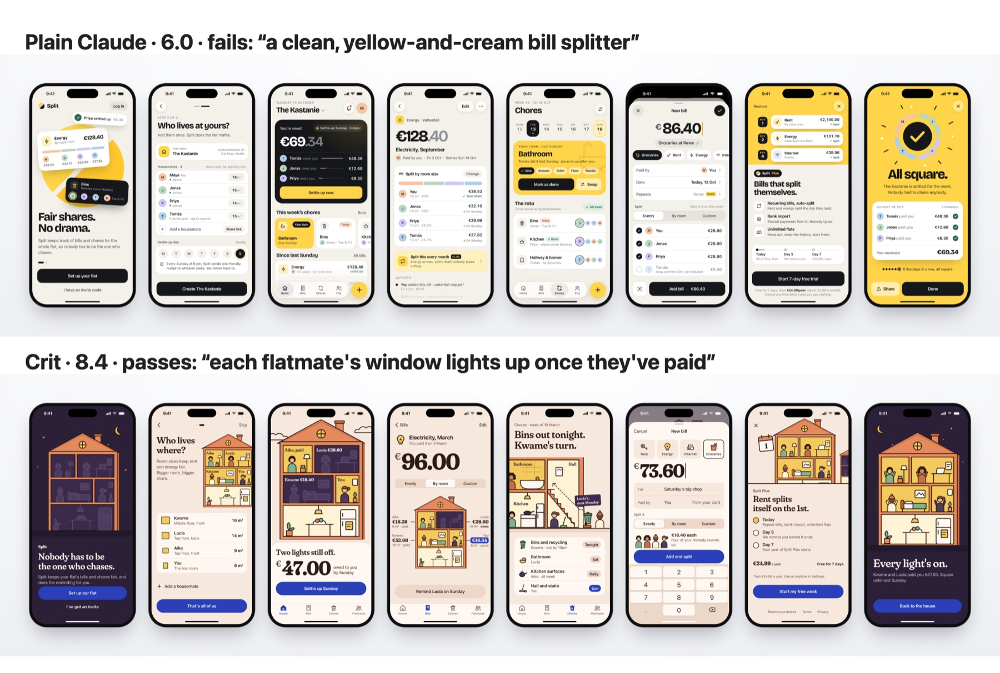
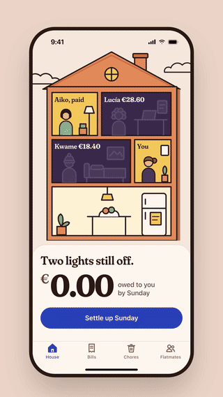
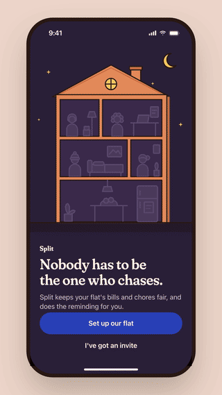
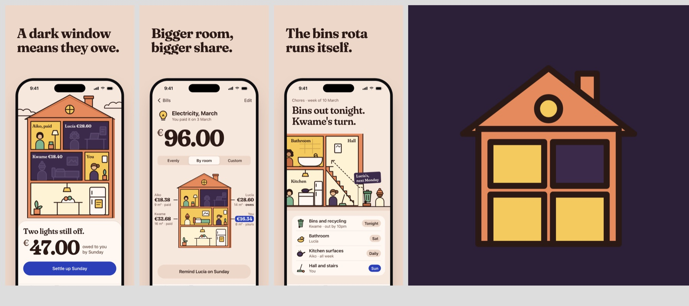
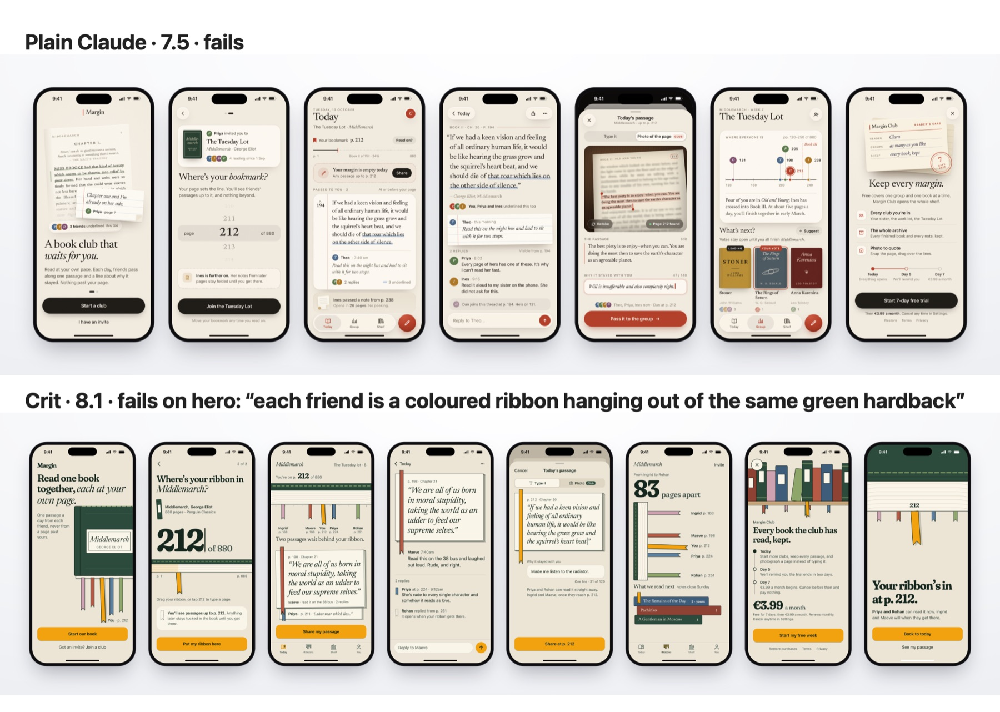

# Crit

**App design that survives a studio critique.** Crit is a Claude Code skill that designs iPhone and Android apps a stranger would remember, then makes the launch kit: motion videos, onboarding and paywall, App Store and Google Play assets.

Clean isn't the goal; it's the floor. Before anything reaches you, a deterministic scanner rejects the tells of AI design, and a strict critic, running as a fresh subagent with a default verdict of *fail*, scores the screens on concept, memorability and hero. Tidy but forgettable doesn't pass.



*Same brief ("a bill-splitting app for housemates"), same model. Both were scored by a critic that saw only the final screens.*

## What you get

From one conversation (*"design my app"*), in a `design/` folder in your project:

- **Three genuinely different directions** to choose from. Each starts from a concrete anchor (a dolls'-house cut-away, a till receipt, a fridge door), not an adjective.
- **iPhone and Android screens**, with Android redesigned in Material 3 rather than ported. They're HTML at device size, rendered to PNG.
- **An onboarding and a paywall** that follow App Store 3.1.2 and Google Play's subscription rules. The scanner checks them.
- **Copy a person would write.** No "Unlock your potential", no Title Case, no lorem ipsum.
- **Motion MP4s** (hero, flow, delight), captured frame by frame so they come out identical every run.
- **Store assets** at the required sizes:
  - App Store screenshots 1320×2868,
  - Play screenshots 1080×1920,
  - an opaque 1024 App Store icon,
  - an adaptive Android icon,
  - a feature graphic.
- **A handoff**: design tokens, components, motion specs, and the critic's open complaints.
- **A gallery** of everything.

<p>
  
  
</p>



## Install

Requirements:
- **macOS**: iOS renders use the system SF Pro font.
- **Node 22+**.
- **Claude Code**.

You don't need Chrome or ffmpeg: Crit uses Playwright's Chromium and `ffmpeg-static`.

In Claude Code:

```
/plugin marketplace add sunilgawai/crit
/plugin install crit@crit
```

That's it. The first time you use it, Crit runs its `doctor` script, which installs its dependencies and downloads Chromium (a few hundred MB). After an update the plugin lives in a new folder, so `doctor` installs again (about a minute).

- **Update:** `claude plugin update crit@crit`.
- **Installed the old way** (`git clone` into `~/.claude/skills/crit`)? Delete that folder after installing the plugin. A personal skill with the same name hides the plugin's.
- **npm 11 with install scripts restricted?** Allow ffmpeg's download script once: `npm approve-scripts ffmpeg-static`.
- **Privacy:** Crit sends nothing anywhere. Those first-run downloads are the only network use. See [PRIVACY.md](PRIVACY.md).

## Use

Open Claude Code in your app's folder, or an empty one, and say *"design my app"*.

- **Questions:** Crit asks at most three, then shows you three directions and waits for your pick. Say *"you decide"* to let it choose.
- **Existing apps:** in an existing codebase it reads your screens, data and copy first, and redesigns the look while keeping the real content.
- **Time and cost:** a full run (both platforms, motion, store assets) takes about 30–40 minutes and a few hundred thousand tokens, because every critique round is a fresh subagent. To design screens only, ask it to stop after the copy pass.

## How it works

```
brief → 3 directions → system → iOS ─┐                ┌→ motion
                                     ├→ final crit ───┤→ store assets
                    Android ─────────┘                └→ handoff
           each batch:  render → scan → critique → one change → repeat (max 4)
```

- **The bar** lives in `plugin/skills/crit/references/taste.md`:
  - a world per app,
  - one signal colour,
  - one hero per screen at an extreme scale,
  - two type voices,
  - illustration the app owns,
  - human copy,
  - native craft.
- **The scanner** (`plugin/skills/crit/scripts/scan.mjs`) runs 25 deterministic rules in Chromium:
  - AI-design tells: Inter for display text, Tailwind indigo, purple-to-blue gradients, emoji icons;
  - contrast measured against what's actually drawn behind the text;
  - text hidden under bars or buttons;
  - touch targets;
  - banned phrases;
  - paywall disclosures;
  - fonts, stylesheets and illustrations that silently fail to load.
- **The critic** (`plugin/skills/crit/agents/critic.md`) scores eight criteria from 1 to 10.
  - It passes only when concept, memorability and hero are each at least 8 and the mean is at least 8.
  - "Clean, modern, minimal" with nothing more specific caps memorability at 6.
  - Each round it asks for exactly **one** change, and it sees the history of earlier changes, so critics don't undo each other.
- **The design source is HTML.** The same files feed the renders, the motion scenes and the store screenshots.

## Does it actually help?

Two briefs, each designed by plain Claude and by Claude with Crit. Every design was scored by a fresh critic that saw only the final iPhone screens and the brief.

| Brief | Plain Claude | Crit |
|---|---|---|
| **Split**, bills and chores for housemates | 6.0, fails: *"a clean, yellow-and-cream bill splitter"* | **8.4, passes**: *"each flatmate's window lights up once they've paid"* |
| **Margin**, a slow book club | 7.5, fails | **8.1, fails on hero**: *"each friend is a coloured ribbon hanging out of the same green hardback"* |



Crit scored higher on concept and memorability for both briefs, and passed the full rule on one.

Limits of this evidence:
- it's only two briefs;
- the critic is the same model family as the designer;
- Crit spends about twice as long iterating;
- the first evaluation run was contaminated and is reported separately.

Method, raw scores and caveats are in [`evals/results.md`](evals/results.md).

## Contributing

`npm test` runs the suite: 98 tests on `node:test`, using Chromium, in about 12s. [`CLAUDE.md`](CLAUDE.md) explains how the repo is put together, the gotchas, and how to change taste or the critic without contaminating the evals. Issues and PRs welcome, especially:
- eval briefs from new genres;
- scanner rules for AI tells the current ones miss.

## Credits

Inspired by [Tobia Donadon's App Designer](https://www.tobiadonadon.com/projects/construct/material/setups/app-designer-pro), whose public description of a taste-first design skill with a critic that's "harder to please" started this. Crit was built independently from that description and uses none of its files.

## License

[MIT](LICENSE) © 2026 Sunil Gawai
